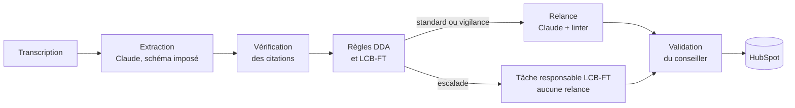

# Débrief

**Le conseiller raccroche. Le CRM est déjà à jour.**

Débrief est un agent IA post-appel pour les conseillers d'un courtier en assurance-vie. À partir de la transcription d'un appel, il produit le compte rendu, prépare la mise à jour HubSpot, contrôle le recueil du devoir de conseil (DDA) et les signaux LCB-FT, puis rédige l'e-mail de relance. Chaque information est sourcée dans l'appel, chaque règle de conformité est du code testé, et rien n'est écrit sans la validation du conseiller.

Prototype réalisé par **Anas Bouguettaya** pour la candidature au stage / alternance IA Engineer chez Basalt (chantier n°1 de l'offre : l'automatisation commerciale). Appels, clients et conseillers fictifs. Projet indépendant, sans lien avec Basalt ni HubSpot.

**Démo interactive :** https://anesbouguettaya.github.io/debrief-basalt/ (ou `demo/index.html`, à ouvrir dans un navigateur).

**Deuxième prototype, Trajectoire :** https://anesbouguettaya.github.io/debrief-basalt/prevision/ : prévoir la croissance d'une jeune fintech avec peu de données (filtre de Kalman, fourchettes d'incertitude, test sur le passé). Voir [plus bas](#trajectoire--prévoir-la-croissance-avec-peu-de-données).

---

## Ce que fait Débrief

| Étape | Qui | Ce qui se passe |
|---|---|---|
| 1. Transcription | code | Lecture des en-têtes et des tours de parole, rôles conseiller / client |
| 2. Extraction | Claude Sonnet 5.5 | Sortie structurée imposée (schéma Pydantic) : compte rendu, recueil DDA, projet, éléments LCB-FT, proposition CRM. Chaque fait arrive avec sa citation |
| 3. Sources | code | Chaque citation est cherchée dans la transcription. Introuvable : la valeur n'atteint jamais le CRM |
| 4. Conformité | code | 12 règles DDA et LCB-FT, versionnées, seuils dans `config.py` |
| 5. Relance | Claude Haiku 5.5 + code | Rédigée à partir des seuls faits vérifiés, relue par 4 contrôles, corrigée une fois si besoin |
| 6. Validation | humain | Diff avant / après et requêtes HubSpot prêtes ; rien n'est écrit sans `--valider` |



## Quatre partis pris

1. **Le modèle comprend, le code décide.** Claude extrait des faits ; les seuils, plafonds et escalades sont des règles Python testées, jamais des consignes de prompt.
2. **Aucun champ sans source.** Une valeur dont la citation n'est pas retrouvée dans l'appel est bloquée. Dans l'appel de démo n°1, le modèle propose une valeur immobilière jamais prononcée : elle est rejetée.
3. **Le conseiller valide.** Débrief prépare ; le conseiller relit et envoie. En escalade LCB-FT, aucune relance automatique ne part (art. L561-18 CMF) et l'origine des fonds reste hors du CRM.
4. **Mesuré dès le premier jour.** Coût et tokens par appel, taux de citations retrouvées, jeu d'évaluation avec erreurs critiques comptées à part.

## Démarrer

```bash
pip install -e ".[mcp]"

# Sans clé API : rejoue les sorties enregistrées
python -m debrief analyser samples/appel_01_moreau.txt --rejouer

# Avec Claude
export ANTHROPIC_API_KEY=...
python -m debrief analyser samples/appel_01_moreau.txt --json resultat.json

# Tests (aucune clé requise)
python -m unittest discover -s tests -t .
```

Extrait de sortie (appel n°1, mode rejeu) :

```
Sources
───────
44/45 citations retrouvées dans l'appel
  ✕ crm.champs[4] : « notre appartement vaut environ 450 000 euros » introuvable → non utilisé

Devoir de conseil · 9/10 rubriques
  → ADQ-01 Recueil des exigences et besoins : À compléter : préférences de durabilité.
    ? Souhaitez-vous qu'une partie de votre épargne soit investie selon des critères de durabilité … ?

LCB-FT · STANDARD
  ✓ LCB-02 Justificatif d'origine des fonds : Versement de 80 000 €, sous le seuil de 150 000 €. Pièce recommandée : attestation du notaire (succession).
```

## Les trois appels de démo

| Appel | Situation | Ce qu'il montre |
|---|---|---|
| `appel_01_moreau` | Héritage, 80 000 €, profil équilibré | Question de durabilité oubliée → générée ; valeur inventée → bloquée |
| `appel_02_dubois` | Vente immobilière, 250 000 €, 67 ans, profil prudent | 40 % de SCPI souhaités → alerte d'adéquation ; justificatif obligatoire ; relance corrigée par le linter |
| `appel_03_marchand` | 180 000 €, origine floue, tiers payeur, espèces | Escalade LCB-FT : aucune relance, données retenues, tâche au responsable |

## Évaluer

```bash
python -m debrief evals --rejouer     # vérifie la mécanique du banc d'essai
python -m debrief evals               # mesure le modèle réel
DEBRIEF_MODELE_EXTRACTION=claude-haiku-5-5 python -m debrief evals   # comparer un modèle 20x moins cher
```

Le banc compare chaque analyse à une vérité terrain annotée à la main (`evals/attendus.json`) : champs extraits, rubriques DDA, règles déclenchées, échéances. Une escalade LCB-FT manquée ou une relance envoyée à tort comptent comme **erreurs critiques** et font échouer le banc.

En mode rejeu, les sorties enregistrées ont été écrites pour la démo : le score de 100 % ne prouve que la mécanique. Les vraies mesures se font avec l'API, puis sur des appels réels anonymisés pendant le pilote.

## Coût

Estimation aux tarifs publics (octobre 2026) : environ **0,045 $ par appel** (Sonnet 5.5 pour l'extraction, Haiku 5.5 pour la relance), soit environ 45 $ pour 1 000 appels. Leviers : cache du prompt système (activé), modèle d'extraction plus léger si les évaluations le permettent, API Batch (-50 %) pour les traitements non urgents.

## HubSpot

1. Créer une application privée avec les droits contacts, transactions et activités (notes, tâches), puis `export HUBSPOT_TOKEN=...`
2. Créer les propriétés personnalisées une fois : `python -m debrief proprietes`
3. `python -m debrief synchroniser samples/appel_01_moreau.txt` affiche le plan ; `--valider` l'exécute.

API CRM v3, identifiants d'association par défaut (note → contact 202, tâche → contact 204, transaction → contact 3…). Les échéances sont converties de l'heure de Paris en UTC. Limite de débit (429) : nouvel essai avec attente.

## Brancher Débrief sur Claude (MCP)

```json
{
  "mcpServers": {
    "debrief": {
      "command": "python",
      "args": ["-m", "debrief.mcp_server"],
      "env": { "ANTHROPIC_API_KEY": "..." }
    }
  }
}
```

Deux outils : `debriefer_appel` (analyse complète) et `questions_a_poser` (rubriques DDA manquantes). Compatible avec les SDK MCP 1.x et 2.x.

## Pourquoi Python ici, et pas n8n ?

n8n ou Make sont parfaits pour la plomberie : webhook de fin d'appel de l'outil de téléphonie, transcription, notification Slack. La logique de conformité, elle, doit être testée unitairement, versionnée et auditable : elle vit en Python. En production, n8n déclenche, Python décide.

## Données personnelles et sécurité

- Les appels enregistrés et transcrits supposent l'information préalable des clients et une base légale validée avec le DPO.
- Conditions de conservation des données côté fournisseur d'IA à vérifier (option de non-conservation pour les données sensibles).
- Les propriétés CRM sont une liste fermée ; en escalade, les éléments LCB-FT ne sont pas écrits dans le CRM.
- Secrets dans des variables d'environnement (`.env.example`).

## Limites

- Les appels sont fictifs ; les sorties enregistrées du dossier `fixtures/` ont été rédigées pour la démo.
- La transcription audio n'est pas incluse : elle se branche en amont (outil de téléphonie ou modèle de transcription).
- Les seuils et références réglementaires sont des exemples à valider avec la conformité et l'assureur.
- Le profil de risque est « pressenti » : il ne remplace pas le questionnaire.

## Trajectoire : prévoir la croissance avec peu de données

Deuxième prototype, dans `prevision/` : prévoir les nouveaux clients et l'encours d'une jeune entreprise qui n'a que quelques mois d'historique. Avec si peu de points, un modèle à milliers de paramètres apprendrait le bruit ; Trajectoire utilise un filtre de Kalman, la méthode qui permet à un robot de se repérer avec des capteurs imparfaits.

| Étape | Méthode |
|---|---|
| Tendance | Filtre de Kalman sur le log des nouveaux clients mensuels (niveau + croissance amortie), trois variances au maximum de vraisemblance |
| Ralentissement | Aucun, modéré ou fort : choisi par l'erreur de prévision à 3 mois sur l'historique, sans regarder la suite |
| Montants | Premier versement moyen et versement mensuel des clients déjà là, par moindres carrés |
| Encours | 2 000 simulations (acquisition, versements, marchés, rachats) : fourchettes 50 % et 80 %, probabilité et date d'atteinte d'un objectif |

Sur les données fictives : 12,3 % d'erreur moyenne à 3 mois sur les nouveaux clients (contre 14,9 % en reconduisant le dernier mois connu), et la réalité dans la fourchette à 80 % 10 fois sur 11. La page permet de rejouer l'historique mois par mois et de coller ses propres chiffres : le calcul se fait dans le navigateur, rien n'est envoyé.

```bash
node --test prevision/test_moteur.js     # 12 tests du moteur, sans dépendance
```

Le moteur (`prevision/moteur.js`) tient dans un seul fichier JavaScript sans dépendance : il tourne dans le navigateur, dans Node et dans un nœud Code de n8n, pour un point mensuel automatique (chiffres HubSpot → prévision → Slack, avec une alerte quand un mois sort de la fourchette).

## Structure

```
debrief/
  pipeline.py      orchestration ; relance à partir des faits vérifiés
  schemas.py       schéma imposé au modèle (Pydantic)
  llm.py           Claude en sortie structurée, cache, coût ; rejeu des sorties enregistrées
  prompts.py       consignes du modèle
  grounding.py     vérification des citations
  compliance.py    règles DDA et LCB-FT
  email_lint.py    relecture des relances
  hubspot.py       diff, plan de requêtes, client API (sans dépendance)
  transcript.py    lecture des transcriptions
  config.py        modèles, tarifs, politique de conformité
  evals.py         banc d'évaluation
  mcp_server.py    serveur MCP
demo/              page de démo autonome et moteur JavaScript (parité vérifiée avec le Python)
prevision/         Trajectoire : moteur de prévision, page et tests
samples/           appels fictifs et fiches CRM « avant »
fixtures/          sorties enregistrées du modèle
evals/             vérité terrain
tests/             tests unitaires
scripts/           export de la démo, test de parité Python / JavaScript
```
